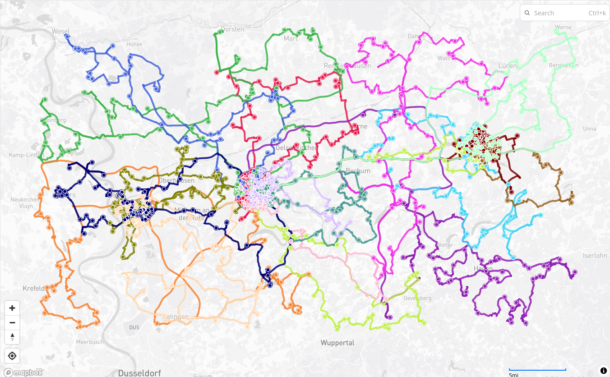
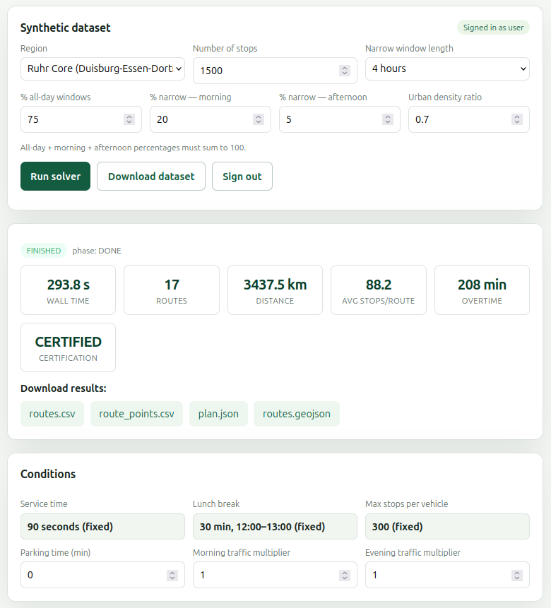

# 🚚 Ruhr Core , Duisburg · Essen · Dortmund

### Fewer routes. Less overtime. Better delivery windows.

*Results of an in-house CVRP-TW algorithm (capacitated vehicle routing with time windows) on a realistic delivery scenario for the Ruhr core (Duisburg, Essen, Dortmund).*

---

## 🗺️ The result at a glance

  

Every colour is one vehicle route. Routes follow the **real road network** (not straight lines), start and end at the depot, and respect each customer's delivery window.

## ⚙️ What the solver reported

  

<!--
Optional: add your headline numbers here, e.g.

| Stops | Routes | Total distance | Time-window violations |
|------:|-------:|---------------:|-----------------------:|
|  ...  |  ...   |      ...       |          ...           |
-->

## 📦 What's in this folder

| File | What it is |
|---|---|
| 📥 [`dataset.csv`](dataset.csv) | **The input.** One row per delivery stop: location, delivery window, service time and parcels. Synthetic, generated for this region. |
| 🚛 [`routes.csv`](routes.csv) | **One line per route** (per vehicle-day): a compact summary to sort, filter and compare in Excel or LibreOffice. |
| 📍 [`route_points.csv`](route_points.csv) | **Every visit, in driving order**, with planned arrival, waiting, service start/end and time-window checks. The file drivers' schedules are built from. |
| 🌍 [`routes.geojson`](routes.geojson) | **Route geometry on the road network.** Opens as an interactive map right here on GitHub, or in QGIS, geojson.io, Kepler.gl, etc. |
| 🖼️ `Screenshot-map.png` | The route map shown above. |
| 🖼️ `Screenshot-solver.png` | The solver's result summary shown above. |

## 🔬 How to read `route_points.csv`

Times are given both as `HH:MM` and as **minutes since midnight** (e.g. `540` = 09:00, `1020` = 17:00), which makes arithmetic easy.

| Column | Meaning |
|---|---|
| `route_id`, `seq` | Which route, and the position of this visit inside it (`0` = departure from depot) |
| `kind`, `stop_id` | `depot` or `stop`, and the customer identifier |
| `lat`, `lon` | Location |
| `win_start_min`, `win_end_min` | The customer's delivery window |
| `service_min`, `parcels`, `parcel_type` | How long the stop takes, and what is delivered |
| `arrival_time` / `arrival_min` | When the vehicle reaches the stop |
| `waiting_min` | Time spent waiting for the window to open |
| `service_start_*`, `service_end_*` | When unloading starts and finishes |
| `tardiness_min` | Minutes late versus the window (`0` = on time) |
| `tw_*_ok` | Time-window compliance flags (`True` = inside the window) |

## 🔎 Try it in 30 seconds

1. **See the routes:** click [`routes.geojson`](routes.geojson) , GitHub draws it on a map.
2. **Find the longest day:** open `routes.csv`, sort by distance or duration.
3. **Audit the windows:** open `route_points.csv`, filter `tardiness_min > 0` to see any late visits.

## ℹ️ About the data

- **All customer data here is synthetic.** Stops are generated on real roads inside the region (urban clusters around Duisburg, Essen and Dortmund, plus suburban scatter); no real customer, address or personal data is used.
- Delivery windows are a realistic mix of all-day windows and narrow morning/afternoon windows.
- This repository contains **results only**; the algorithm itself is not published here.
- Map data © [OpenStreetMap contributors](https://www.openstreetmap.org/copyright), available under the [ODbL](https://opendatacommons.org/licenses/odbl/).

## 📄 License

The datasets, result files and images in this repository are released under **CC BY-NC 4.0** (see the `LICENSE` file in the repository root) , free to download, test and share with attribution, for non-commercial use. The algorithm that produced them is **not** part of this repository and is not covered by this license.

---

**Questions, or curious about the approach?** Get in touch, contact details here.

CVRP-TW · Real roads · Realistic constraints

