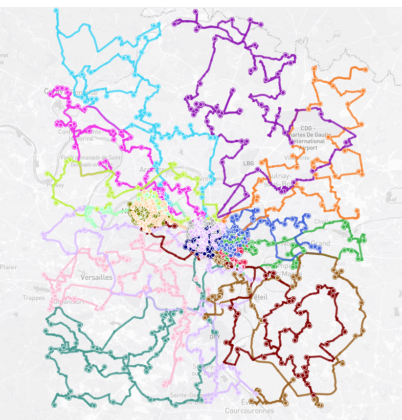

# 🚚 Vehicle Routing Showcase

### Fewer routes. Less overtime. Better delivery windows.

*Delivery route plans for three European metro areas, computed on real roads by an in-house CVRP-TW algorithm.*

---

<table>
  <tr>
    <td align="center" width="33%">
      
       <b>🇩🇪 Ruhr Core</b> Duisburg · Essen · Dortmund
       <a href="Germany-Ruhr-core">Open results →</a>
    </td>
    <td align="center" width="33%">
      
       <b>🇫🇷 Grand Paris</b> Paris · La Défense · Petite Couronne
       <a href="Grand-Paris">Open results →</a>
    </td>
    <td align="center" width="33%">
      
       <b>🇳🇱 Amsterdam – Utrecht</b> Amsterdam · Utrecht · Amstelveen
       <a href="The-Nederlands-Amsterdam-Utrecht">Open results →</a>
    </td>
  </tr>
</table>

## The problem

A depot, hundreds or thousands of customers, vehicles with limited capacity, and customers who only accept delivery inside a time window. Every extra route is another vehicle and driver; every late arrival is a failed delivery. This is the **Capacitated Vehicle Routing Problem with Time Windows (CVRP-TW)**, and it gets very hard very fast as the number of stops grows.

This repository shows what the algorithm produces on three realistic day-of-delivery scenarios: not slides or promises, but the actual route files, which you can open, sort and check yourself.

## Why trust the numbers

- 🗺️ **Real roads.** Routes and travel times follow the actual road network, not straight lines.
- 🔍 **Everything is inspectable.** Each region folder contains the input stops, every route, and every visit with its planned arrival and time-window check.
- 🧾 **Problems are visible, not hidden.** Any remaining overtime or late visit shows up in the CSV files; nothing is smoothed over.

<!--
Optional: add the headline numbers of each region (copy them from each solver screenshot).

| Region | Stops | Routes | Total distance | Overtime | Time-window violations |
|---|---:|---:|---:|---:|---:|
| Ruhr Core | ... | ... | ... | ... | ... |
| Grand Paris | 1,500 | 19 | 2,984.7 km | 40 min | 0 |
| Amsterdam – Utrecht | ... | ... | ... | ... | ... |
-->

## Where to look

Each region folder has its own README that explains the files and how to read them. A good starting point:

1. Open a region's **`routes.geojson`**: GitHub draws the routes on an interactive map.
2. Open **`routes.csv`**: one line per route (stops, distance, shift length, overtime).
3. Open **`route_points.csv`**: every visit in driving order, with arrival time and window check.

## Scope and limits

- **Synthetic data.** Stops are generated on real roads; no real customers, addresses or personal data are involved. Results show how the algorithm behaves on realistic scenarios, not on any company's operations.
- **Results only.** The algorithm itself is not published in this repository.
- **No head-to-head claims.** These plans are not benchmarked here against other solvers or planners.

## License and attribution

Datasets, result files and images: **CC BY-NC 4.0** (see [`LICENSE`](LICENSE)). Free to download, test and share with attribution, for non-commercial use.
Map data © [OpenStreetMap contributors](https://www.openstreetmap.org/copyright), available under the [ODbL](https://opendatacommons.org/licenses/odbl/).

---

**Questions, or interested in the approach?** Get in touch — contact details here.

